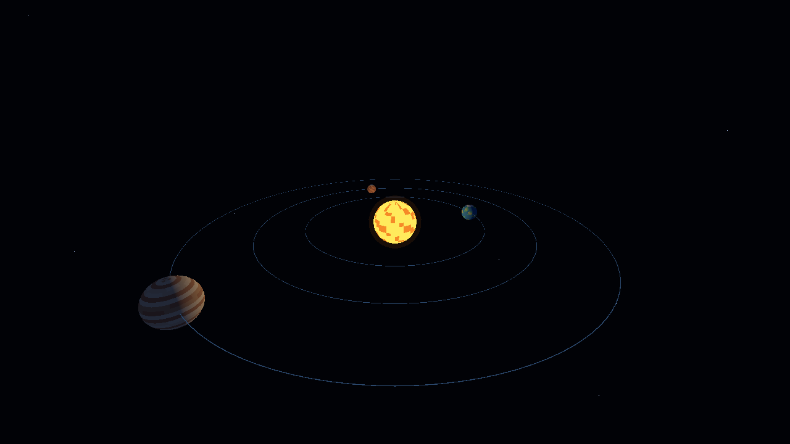

# Sistema solar 3D · Godot MVP

Proyecto pequeño para probar el flujo **Blender → GLB → Godot → escena interactiva** en Windows. Incluye el Sol, la Tierra, Marte y Júpiter, órbitas animadas, estrellas y una cámara libre. Las escalas y velocidades son ilustrativas.



## Requisitos

| Para | Herramienta | ¿Es necesaria? |
| --- | --- | --- |
| Abrir y ejecutar | [Godot Engine 4.7.2 para Windows x86_64, versión estándar](https://godotengine.org/download/windows/) | Sí |
| Regenerar los modelos GLB | [Blender 4.5.14 LTS](https://www.blender.org/download/lts/) | Solo si se modifican los modelos |

Godot se distribuye como ZIP portable: basta extraerlo y ejecutar el `.exe`. La variante **.NET** y su SDK no hacen falta; el proyecto usa GDScript. Los cuatro GLB ya están incluidos. Blender trae su propio Python y `bpy`, por lo que tampoco se necesita instalar Python por separado. No hay plugins ni paquetes externos.

## Abrir y ejecutar

1. Descarga o clona este repositorio.
2. Abre `project.godot` con Godot 4.7.2.
3. Espera a que Godot importe los cuatro archivos de `assets/models/`.
4. Pulsa **F5** para iniciar. También puedes abrir `scenes/solar_system.tscn` y pulsar **F6**.

La escena se construye al ejecutarse; por eso la vista del editor puede parecer vacía antes de pulsar F5. No hay que exportar un ejecutable de Windows para esta prueba local.

## Controles

| Acción | Control |
| --- | --- |
| Avanzar, retroceder y desplazarse | WASD |
| Mirar | Ratón |
| Subir / bajar | E / Q o Espacio / Ctrl |
| Moverse más rápido | Shift |
| Acercarse / alejarse | Rueda del ratón |
| Liberar el cursor | Esc |
| Capturar el cursor otra vez | Clic izquierdo |

No hay colisiones: la cámara puede atravesar los planetas. Puedes acercarte a cualquiera de ellos con WASD o la rueda.

## Regenerar los modelos con Blender

Los GLB se generaron con [`tools/export_planets.py`](tools/export_planets.py). Desde la raíz del proyecto, con `blender` disponible en el PATH:

```powershell
blender -b --python tools/export_planets.py -- --stage=all
```

Si usas el ZIP portable en Windows, sustituye `blender` por la ruta de `blender.exe`. `--stage=basic` exporta solo Sol y Tierra; `--stage=all` exporta los cuatro cuerpos. Al regresar al editor, Godot reimporta los GLB modificados.

## Estructura

```text
assets/models/          GLB listos para importar
docs/preview.png        Captura de referencia
scenes/solar_system.tscn Escena principal
scripts/solar_system.gd  Órbitas, iluminación, estrellas y cámara
tools/export_planets.py Fuente de los modelos en Blender
project.godot           Configuración del proyecto
```

El proyecto usa geometría y materiales simples, sin texturas grandes, partículas ni shaders costosos. Arranca a 1280 × 720 con el renderizador GL Compatibility. Para probar 1920 × 1080, cambia el tamaño de ventana en los ajustes del proyecto y mide los FPS en tu equipo. No se ha establecido una garantía de 60 FPS para todas las GPU.
